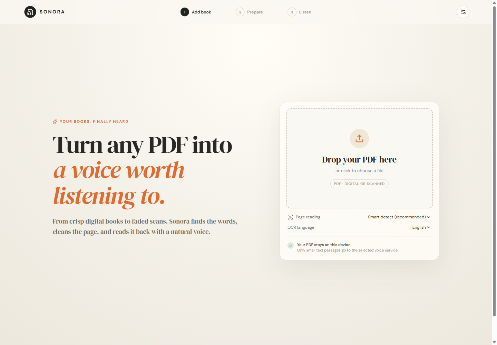
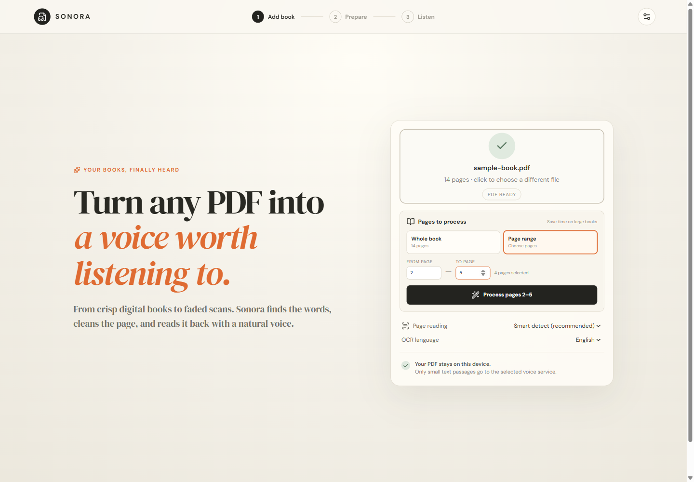

# Sonora — PDF to Audiobook

[](https://pdf2audiobook.weiwei.website)

Sonora turns digital PDFs and scanned books into natural-sounding audiobooks. PDF parsing and OCR happen in the browser; only small cleaned text chunks are sent to the selected voice service.



## Features

- Extracts embedded PDF text with PDF.js.
- Automatically OCRs image-only or hard-to-read pages with Tesseract.js.
- Enhances low-contrast scans before recognition.
- Lets you choose the whole book or a page range **before processing**, avoiding unnecessary OCR on large books.
- Removes repeated headers, footers, page numbers, broken line wraps, and hyphenation.
- Provides an editable manuscript before narration.
- Plays long books progressively and exports the finished narration as MP3.
- Supports three voice engines:
  - **Neural / free:** Microsoft Edge online neural voices, with no API key.
  - **OpenAI:** `gpt-4o-mini-tts` with voice and narration-direction controls.
  - **VibeVoice / custom:** any local OpenAI-compatible `/v1/audio/speech` endpoint.



## Use the hosted app

1. Open <https://pdf2audiobook.weiwei.website>.
2. Drop or select a PDF. The browser performs a quick page-count check only.
3. Choose **Whole book** or **Page range**. For example, enter pages 1–20.
4. Choose embedded text, automatic OCR, or OCR for every page, plus the document language.
5. Select **Process** and review the cleaned manuscript.
6. Pick a narrator, listen immediately, or create an audiobook MP3.

For OpenAI narration, enter an API key in Voice Studio. The key remains in browser memory for the current page session and is sent only to this app's speech proxy. OpenAI-generated speech should be disclosed as AI-generated when shared.

## Run locally

Requirements: Node.js 20 or newer and an internet connection for OCR language data and online voices.

```powershell
npm install
npm run dev
```

Open <http://localhost:5173>. The Vite frontend proxies `/api` to the local API on port 8787.

To configure OpenAI on the server instead of entering a key in the browser:

```powershell
$env:OPENAI_API_KEY="your-key"
npm run dev
```

## Production

```bash
npm ci
npm run build
NODE_ENV=production HOST=127.0.0.1 PORT=8791 npm start
```

Production examples for systemd and Nginx are in [`deploy/`](deploy/). Nginx serves `dist/` and proxies `/api/` to the private Node service.

## Connect VibeVoice

Choose **VibeVoice / custom server** and enter a running OpenAI-compatible speech URL, commonly:

```text
http://127.0.0.1:8000/v1/audio/speech
```

Model and voice fields are passed through to the configured server. The large model and its hardware-specific runtime therefore remain optional and separate from Sonora.

## Architecture and privacy

- The original PDF never reaches the Sonora server.
- PDF parsing, scan rendering, image enhancement, and OCR run in the browser.
- Tesseract language data is downloaded on first use and cached by the browser.
- Only selected, cleaned text chunks are sent to the chosen TTS provider.
- Using a local custom endpoint keeps narration text local as well.

## Verify

```bash
npm test
npm run build
```
