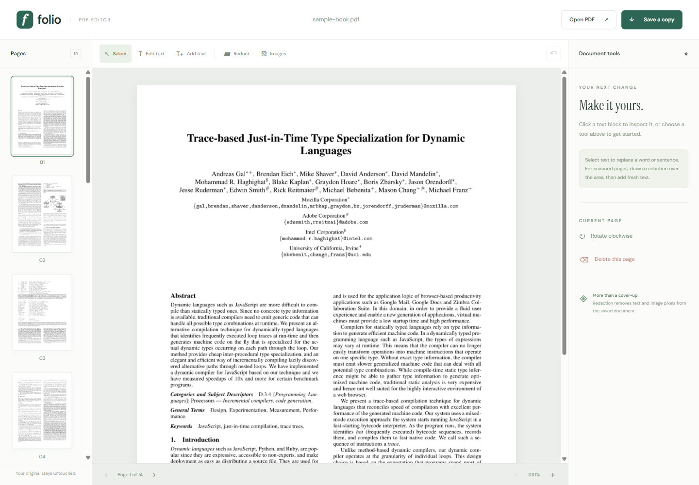

# Folio PDF editor

A minimalist PDF editor with real redaction, text replacement, added text, image removal, page deletion, rotation, undo, thumbnails, and PDF export.

Live app: https://pdfeditor.weiwei.website

Source: https://github.com/monkeyKingProgrammer/pdf2audiobook/tree/main/pdf-editor



## Run

```powershell
uv venv .venv
uv pip install --python .venv/Scripts/python.exe -r requirements.txt
.venv/Scripts/python.exe -m uvicorn app:app --host 127.0.0.1 --port 8792
```

On Linux use `.venv/bin/python`. Open http://localhost:8792.

## Use

Open a PDF. Select **Edit text** and click a text run, or draw a larger area for replacement. Choose **Add text** and draw a box to insert text. Choose **Redact**, draw an area, choose white or black fill, and apply. Choose **Images**, click an image, and apply to remove its pixels. Page tools rotate or delete the current page. **Save a copy** downloads a rewritten PDF; the original file is unchanged.

Redaction applies actual PDF content removal through PyMuPDF and rewrites the file with garbage collection. Covered image pixels are removed, including those on scanned pages. Image removal preserves overlapping text. Text replacement currently supports Latin characters using Helvetica, does not reflow surrounding paragraphs, and refuses changes that do not fit. Scanned text can be removed with area redaction and replaced using added text. This is not an OCR or word-processing tool.

PDFs are sent to the editor server over HTTPS and held in process memory. Sessions expire after an hour of inactivity. Up to ten undo snapshots are available during a session; these are never included in downloads. Closing a document by opening a new one deletes its server session. PDF metadata is cleared on download. No global sanitization of attachments, comments, or content outside the selected redaction areas is promised.

Maximum file size: 40 MB. Maximum page count: 1000. Password-protected PDFs must first be unlocked. Documents with digital signatures will need to be signed again after editing.

PyMuPDF is licensed under AGPL-3.0 or a commercial license. Review its licensing requirements when distributing or operating modified versions.

Folio's source in this directory is provided under AGPL-3.0-or-later. See LICENSE. The parent Sonora application is a separate project.
